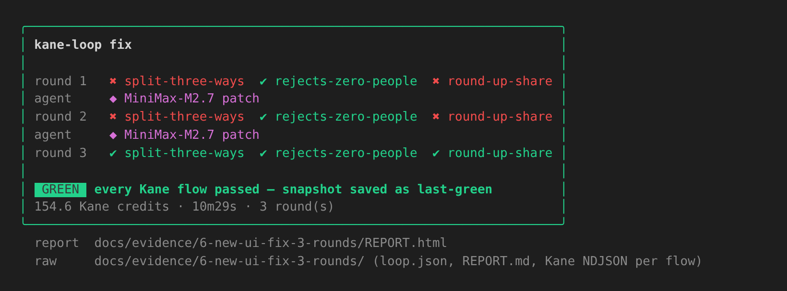
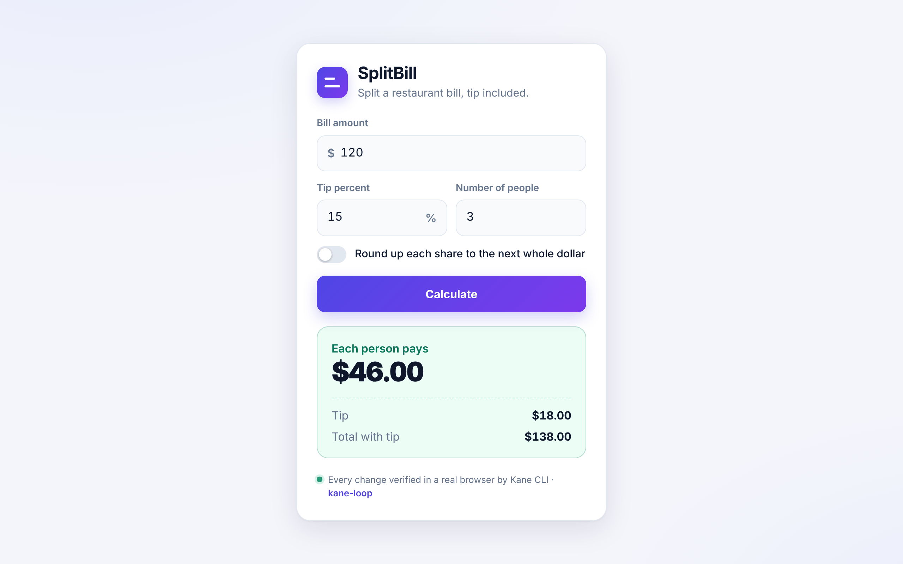
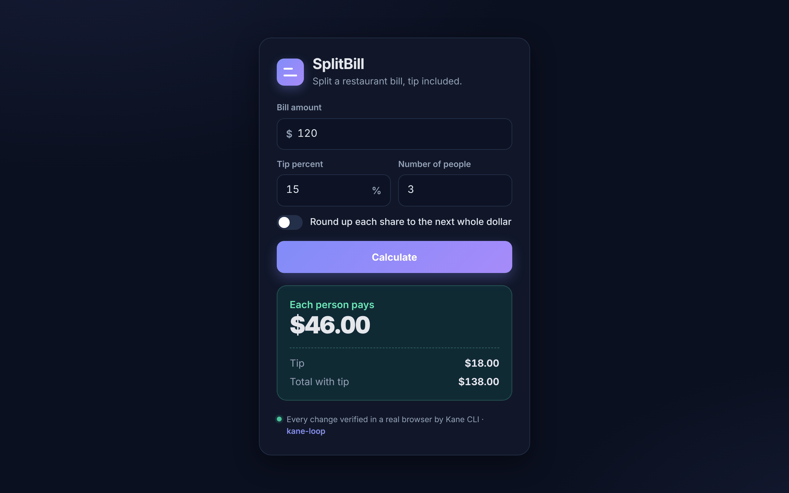
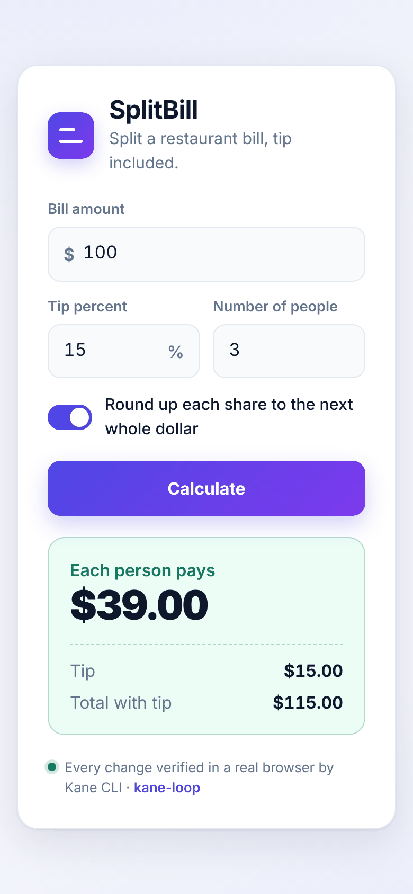
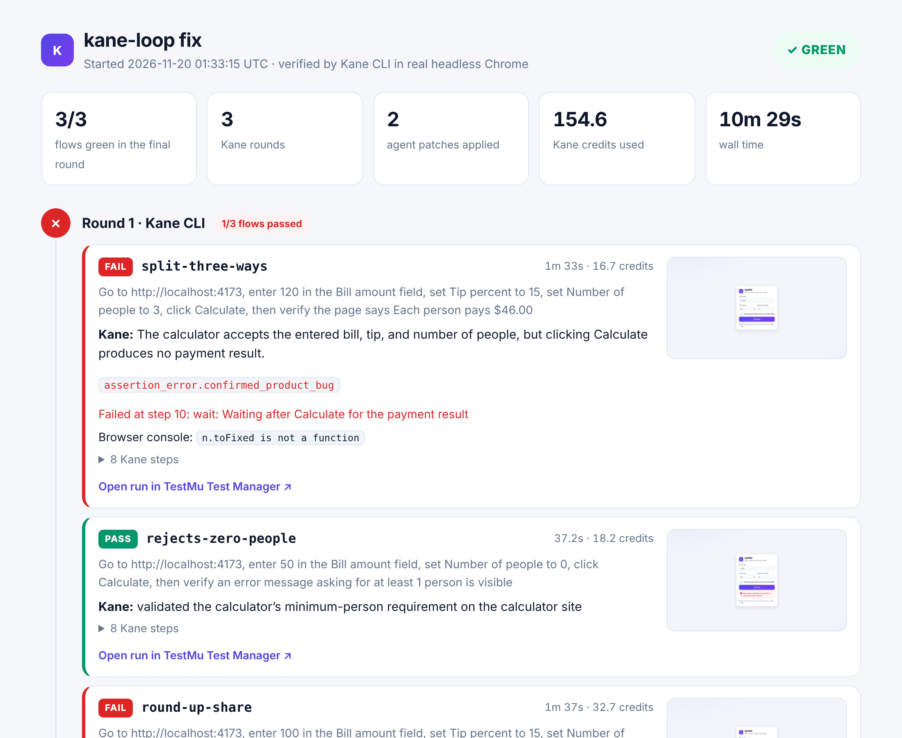

# kane-loop — an agent that can't ship until Kane CLI says green

**kane-loop** closes the loop between a coding agent and [Kane CLI](https://www.testmuai.com/kane-cli/).
You describe what the app must do as plain-English Kane flows. kane-loop runs them in a real Chrome,
reads Kane's NDJSON stream and sealed evidence pack, hands the structured failure to the agent,
applies the agent's patch, and runs Kane again — until every flow is green.

```
  edit (agent or you) ──► kane-cli run --agent (real Chrome) ──► NDJSON run_end + evidence pack
          ▲                                                              │
          │                     FAIL: failing step, Kane's reason,      │
          └──── agent patch ◄── console errors, failure.yaml ◄──────────┘
                                 PASS on every flow ──► snapshot "last green" ──► done
```

Built for the **Kane CLI Online Hackathon** (TestMu AI, 12–19 Nov 2026). Repo created 16 Nov 2026.

The demo app is **SplitBill**, a small bill splitter (bill, tip %, people → what each person pays),
plus a "round up each share" option that the kane-loop agent itself implemented and Kane verified.

<p align="center">
  
</p>

| SplitBill (light) | SplitBill (dark) | Mobile + round-up |
|---|---|---|
|  |  |  |

Every run also writes a self-contained **`REPORT.html`**: verdict, credits and time, a timeline of Kane rounds and
agent patches, Kane's reason code, the browser console error, the diff, and Kane's last screenshot for each flow
(follows the system light/dark setting). Example: [`docs/evidence/6-new-ui-fix-3-rounds/REPORT.html`](docs/evidence/6-new-ui-fix-3-rounds/REPORT.html)
(download it and open it in a browser; GitHub shows HTML as source).

<p align="center"></p>

## What it does

| command | what happens |
|---|---|
| `kane-loop verify` | runs every flow in `kane-loop.config.json` with `kane-cli run --agent --headless`; exit 0 only if every `run_end` says `passed` |
| `kane-loop fix` | verify → on failure build a failure report from Kane's output → agent returns a patch → patch is validated and applied → verify again (max 4 rounds) |
| `kane-loop task "<change>" --flow "<objective>"` | the agent implements a feature, then the same loop proves it with the existing flows **plus** the new flow |
| `kane-loop watch --fix` | file watcher: every save of an app file fires Kane; if it fails, the agent repairs it and Kane re-verifies |
| `kane-loop report [<run dir>]` | rebuilds `REPORT.html` from a run's `loop.json` (no Kane credits) and prints the scoreboard |

What the agent gets from Kane (see `lib/kane.mjs`, `lib/agent.mjs`):

- `run_end`: `status`, `reason`, `reason_code` (e.g. `assertion_error.confirmed_product_bug`), `summary`, `final_state`, assertion memory (expected vs observed)
- the failing step (`status: failed`) and the last steps before it
- from the sealed `.evidence` pack: browser console log (`*-console.ndjson`), `failure.yaml`, and the last screenshot

The agent must answer with JSON edits (`file`, exact `find`, `replace`). kane-loop rejects edits to files
outside `app.files` and any `find` that does not match exactly once, so a bad reply cannot scribble over the repo.

**Agent:** MiniMax-M2.7 through its OpenAI-compatible API (`MINIMAX_API_KEY`).
**Deterministic fallback:** if there is no key, the API fails, or the patch is unusable, kane-loop restores the
app files from the last snapshot that Kane verified green and re-runs Kane to prove the rollback. `--no-agent`
forces this path. So the loop still closes without any LLM.

## Run it (one command for the app)

Requirements: Node 18+, Google Chrome, a TestMu AI account (free credits at https://www.testmuai.com/kane-cli/).

```bash
git clone https://github.com/qinheyi/kane-loop && cd kane-loop
npm run app                       # SplitBill at http://localhost:4173  (no dependencies to install)
```

Then, in another terminal:

```bash
npm install -g @testmuai/kane-cli
kane-cli login                    # or, in CI: KANE_LOOP_CI_AUTH=1 with LT_USERNAME / LT_ACCESS_KEY in the env
node bin/kane-loop.mjs verify     # 3 flows, real Chrome, ~35 s each

# the closed loop:
node scripts/break.mjs            # DEMO: simulates a bad agent edit (drops parseFloat on the bill input)
export MINIMAX_API_KEY=...        # optional; without it the deterministic rollback fixer is used
node bin/kane-loop.mjs fix        # Kane fails -> agent reads the failure -> patch -> Kane green

node bin/kane-loop.mjs watch --fix   # leave running, then save a broken app/app.js
```

`KANE_LOOP_URL=https://your-deploy.example node bin/kane-loop.mjs verify` points every flow at another deployment.
`npm test` runs the unit tests for the NDJSON parsing and the patch guard (no Kane credits needed).

Every run writes `.kane-loop/runs/<time>-<command>/` with `REPORT.html`, `REPORT.md`, `loop.json`, the raw Kane NDJSON per flow,
the failure report sent to the agent, the agent's reply, the applied `patch.diff` and screenshots.

## Real runs (16 Nov 2026, kane-cli 0.10.4, headless Chrome)

All logs below are unedited output of real runs, copied from `.kane-loop/runs/` into [`docs/evidence/`](docs/evidence/).

| # | run | result | Kane credits |
|---|---|---|---|
| 1 | [`verify`](docs/evidence/1-verify-green/REPORT.md) on the first version | 2/2 flows green | 35.8 |
| 2 | [`break` + `fix` with MiniMax](docs/evidence/2-fix-with-minimax/REPORT.md) | round 1 FAIL → agent patch → round 2 green | 66.7 |
| 3 | [`task "round up each share"`](docs/evidence/3-task-round-up/REPORT.md) | agent implemented the feature, 3/3 flows green first try | 47.5 |
| 4 | [`break` + `fix --no-agent`](docs/evidence/4-fix-fallback-rollback/REPORT.md) | FAIL → rollback to last green → green | 96.3 |
| 5 | [`watch --fix`, then a bad save](docs/evidence/5-watch-on-save/REPORT.md) | save fired Kane → FAIL → MiniMax patch → green | 81.1 |
| 6 | [`break` + `fix` on the redesigned UI (20 Nov)](docs/evidence/6-new-ui-fix-3-rounds/REPORT.md) | round 1 FAIL → MiniMax patched only the symptom (`Number(n).toFixed`) → **Kane caught the wrong total ($4006.00 instead of $46.00)** in round 2 → MiniMax fixed the root cause → round 3 green on all 3 flows | 154.6 |
| 7 | [`break` + `fix` for the v2 demo video (20 Nov)](docs/evidence/7-demo-v2-fix/REPORT.md) | round 1 FAIL (`confirmed_product_bug`, console `n.toFixed is not a function`) → MiniMax patch → round 2 green on all 3 flows | 104.9 |

Run 6 shows why the loop matters: the agent's first patch made the crash go away, and a "does it render?" check
would have passed. Kane's assertion on the actual amount rejected it, and the agent got the new evidence and fixed
the real bug. Full colored transcript: [`docs/screenshots/cli-fix-run.png`](docs/screenshots/cli-fix-run.png).

What Kane caught in run 2 (from `run_end`, [failure-report.json](docs/evidence/2-fix-with-minimax/iter-1/failure-report.json)):

> reason_code `assertion_error.confirmed_product_bug` — "Valid inputs were confirmed and Calculate clicked twice,
> but no result text or result element appears." Console evidence: `n.toFixed is not a function`.

What the agent answered ([agent-reply.json](docs/evidence/2-fix-with-minimax/iter-1/agent-reply.json)), 2,160 tokens:

> "The Bill amount input value is read as a string, so multiplication yields a string and `money()` crashes when
> calling `toFixed()`. Parse the bill as a number before validation and calculation."

```diff
-  const bill = document.getElementById("bill").value;
+  const bill = parseFloat(document.getElementById("bill").value);
```

Round 2: all flows `passed`. Terminal transcripts: [`docs/evidence/terminal/`](docs/evidence/terminal/). Each run folder also has a `REPORT.html` (rebuilt with `kane-loop report`).
Screenshots from Kane's evidence pack: the [failed run](docs/evidence/5-watch-on-save/iter-1/split-three-ways/last-screenshot.jpg)
(no result after Calculate) and the [green run](docs/evidence/5-watch-on-save/iter-2/round-up-share/last-screenshot.jpg).

Note: `scripts/break.mjs` is a scripted stand-in for a bad agent edit so the demo is repeatable. The feature in run 3
was written by the in-loop agent; the rest of this repo was written with an AI coding agent (Grok Bot) and checked
with Kane CLI as shown above.

## Layout

```
app/                 SplitBill (index.html, app.js, style.css)
server.js            zero-dependency static server, no-store caching so edits are live
kane-loop.config.json  app url/start command, editable files, Kane flows
bin/kane-loop.mjs    CLI: verify / fix / task / watch / report
lib/kane.mjs         spawns kane-cli --agent, parses NDJSON, reads the .evidence pack
lib/agent.mjs        MiniMax agent, patch guard, last-green snapshot + rollback fallback
lib/ui.mjs           terminal styling (colors on a TTY; NO_COLOR / FORCE_COLOR respected)
lib/report.mjs       self-contained REPORT.html per run
scripts/break.mjs    demo regression; scripts/secret-scan.mjs pre-push secret guard
scripts/demo-video.py  renders the demo video from a real run's colored log, Kane screenshots and REPORT.html
docs/evidence/       real run logs and screenshots
docs/screenshots/    README images (before/after of the 20 Nov UI polish: docs/screenshots/before-after.png)
```

## Limits

- Each Kane run costs credits (about 10–22 per flow here). Saved `_test.md` replays would be cheaper; not wired in yet.
- The agent sees only the files listed in `app.files`; that keeps prompts small and patches reviewable.
- The rollback fallback can only restore a state Kane has already verified; it does not invent fixes.

MIT licensed.
